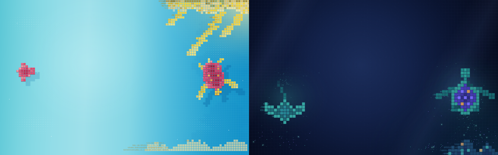

# Antigravity Honu

给 macOS 上的 Google Antigravity 桌面版加上海景皮肤和 Dock 红色角标。浅色 **Honu Lagoon** 和深色 **Night Reef** 都带有动态海景和半透明会话面板。切到别的应用工作时，看一眼 Dock 就知道有几个会话需要回来处理。



## 安装

需要 Python 3、Git，以及已经运行的[船板 Antigravity 主题补丁](https://github.com/Anarcadia/chuanban-antigravity-theme-patch)。Honu 通过这个补丁的用户脚本和样式入口加载。首次使用船板补丁，请先按其 README 安装并运行 `node install.mjs verify`；已有补丁的用户可直接运行以下命令。

```sh
git clone https://github.com/siyuanfeng636-cpu/antigravity-honu.git
cd antigravity-honu
python3 install.py install
```

打开 Antigravity 主窗口，等几秒让补丁重新加载。标题栏出现「海景主题」菜单后即可选择浅色、深色、跟随系统或关闭海景。首次安装默认深色，在界面里选择的模式会保存。Dock 角标独立于配色，关闭海景后也能使用。

## 角标怎样计数

| 会话状态 | Dock 上的表现 |
| --- | --- |
| Agent 等你回答正式提问、确认命令或授予权限 | 该会话计 1，处理后清除 |
| Agent 已结束本轮，最后一条回复尚未查看 | 该会话计 1，打开并查看后清除 |
| 最后一条回复是「要继续吗？」 | 和其他已结束的未读回复一样计 1 |
| 同一会话有多个问题，或父会话转发同一请求 | 按来源会话去重 |
| 已取消、已查看且没有待处理请求 | 清除该会话的计数，总数为 0 时隐藏角标 |

保留至少一个 Antigravity 主窗口，切到后台或最小化均可。脚本从桌面版已有的会话状态计算数量，不解析消息正文。它依赖 Antigravity 的内部状态字段，客户端大版本升级后可能需要适配。

## 横幅和睡眠专注

横幅由 Antigravity 和 macOS 发送。要同时收到系统横幅和 Dock 角标，可按需调整以下设置。

1. 在 Antigravity 设置中打开「启用 Agent 系统通知」。需要声音时再打开「启用 Agent 提示音」。
2. 在「系统设置 → 通知 → Antigravity」允许通知和桌面横幅。若希望横幅保留到手动关闭，将样式选为「持续」。
3. 若睡眠期间也要看到横幅，在「系统设置 → 专注模式 → 睡眠 → 允许的 App」加入 **Antigravity**。这会同时放行任务完成和需要人工处理的通知。

## 更新和卸载

在克隆的仓库目录中运行以下命令。

```sh
git pull --ff-only
python3 install.py install
```

卸载只需运行以下命令。

```sh
python3 install.py uninstall
```

安装器只管理 `~/.gemini/antigravity/theme-patch/user/custom.js` 和 `custom.css` 里的 Honu、Dock 标记块。修改前的文件保存在 `~/.gemini/antigravity/theme-patch/backups/honu-*`，具体路径会打印在终端。

## 验证

在仓库根目录运行 `python3 -B -m unittest discover -s test` 可验证安装、重复安装和卸载。运行 `node --test`（Node.js 22 或更高版本），可离线测试完成未读、审批、去重及切回前台。要检查实际 Dock 图标，可以让后台会话完成一轮普通回复，看到红色数字后打开该会话，确认数字随之减少。

Dock 角标在 Antigravity 2.33.0 上做过真实 Dock 显示与清除测试。2.34.0 已检查角标订阅和未读、待处理索引。使用的加载器版本为船板补丁 5.5.1。

## 海景素材

Honu Lagoon 和 Night Reef 的场景生成器来自 Anthropic 的 `theme-examples`，以 Apache-2.0 分发。仓库附有生成器源码、渲染后的 SVG 与完整许可证。[场景来源及重建方法](theme/scenes/README.md) · [场景许可证](theme/scenes/LICENSE)
